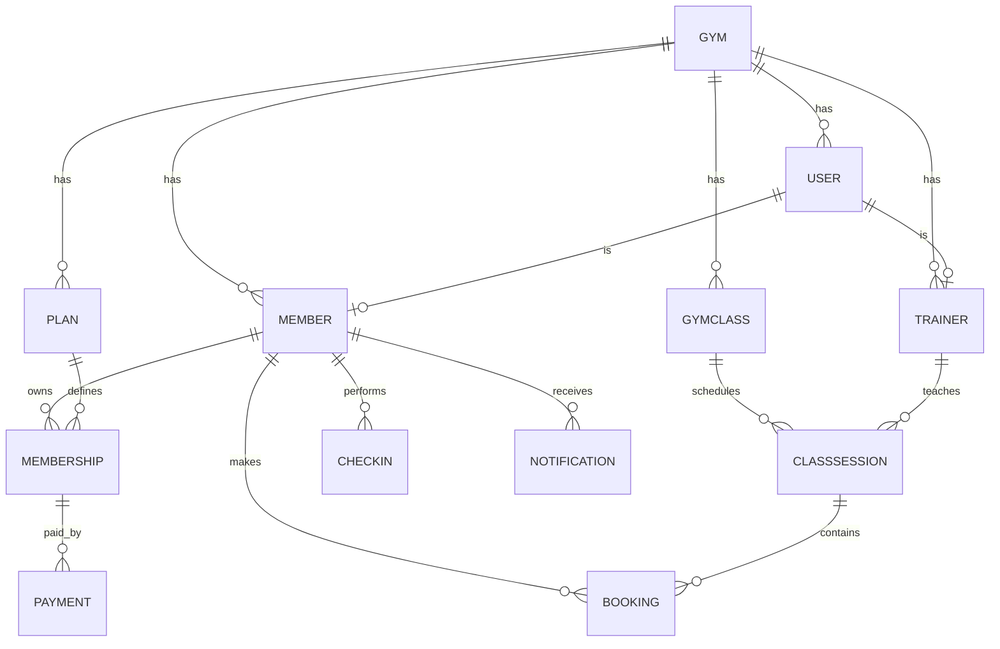

# PROJECT BRIEF — GymPilot

## 1. Tổng quan dự án

- **Tên sản phẩm**: GymPilot
- **Loại sản phẩm**: Web application quản lý phòng gym/yoga/pilates boutique nhỏ.
- **Khách hàng mục tiêu**: Gym, studio yoga/pilates/CrossFit có 30–300 hội viên, 1–3 huấn luyện viên, 1–3 chi nhánh.
- **Mục tiêu MVP**: Giúp chủ gym quản lý hội viên, gói tập, lịch lớp, đặt lớp, check-in QR, thanh toán và báo cáo trong một hệ thống duy nhất.
- **Thời gian**: 45 ngày, 2 lập trình viên, phát triển bằng Antigravity.
- **Ngôn ngữ giao diện**: Tiếng Việt.
- **Mức độ hoàn thành mục tiêu**: MVP có thể bán thử cho 2–3 gym thật.

### Phạm vi MVP

#### Làm trong MVP:
- Đăng nhập, phân quyền: Owner, Staff, Trainer, Member.
- Quản lý hội viên.
- Quản lý gói tập: tháng, quý, gói buổi, vé lẻ.
- Mua gói, ghi nhận thanh toán, gia hạn.
- Lịch lớp theo tuần, sức chứa, huấn luyện viên phụ trách.
- Hội viên đặt/hủy lớp, waitlist khi lớp đầy.
- Check-in bằng QR và check-in thủ công bởi staff.
- Trừ số buổi còn lại khi check-in lớp áp dụng gói buổi.
- Nhắc hội viên: sắp hết hạn, sắp hết buổi, lớp sắp diễn ra.
- Dashboard: doanh thu, hội viên hoạt động, lớp đông nhất, tỷ lệ check-in.
- Import hội viên từ CSV/Excel.
- Trang landing page công khai giới thiệu gym.

#### Không làm trong MVP:
- Ứng dụng mobile native iOS/Android.
- POS bán nước, đồ dùng, quản lý kho.
- Kiểm soát cửa tự động 24/7.
- Đa chi nhánh phức tạp, franchise.
- AI dự báo churn nâng cao.
- Tích hợp thanh toán tự động đầy đủ trong tuần đầu; MVP dùng ghi nhận chuyển khoản/tiền mặt trước.

---

## 2. Vai trò người dùng

| Vai trò | Mô tả | Quyền chính |
|---|---|---|
| **OWNER** | Chủ gym | Toàn quyền: hội viên, nhân viên, lớp, gói, thanh toán, báo cáo, cấu hình gym |
| **STAFF** | Lễ tân / quản lý vận hành | Quản lý hội viên, check-in, bán gói, xác nhận thanh toán, quản lý booking |
| **TRAINER** | Huấn luyện viên | Xem lớp được phân công, điểm danh, xem hồ sơ hội viên cơ bản |
| **MEMBER** | Hội viên | Xem gói, lịch lớp, đặt/hủy lớp, xem lịch sử check-in, thanh toán của mình |

---

## 3. Use Case chính

### UC-01: Owner đăng ký và khởi tạo gym
- **Actor**: Owner
- **Mô tả**: Owner tạo tài khoản, tạo gym, cấu hình thông tin cơ bản.
- **Điều kiện tiên quyết**: Chưa có tài khoản.
- **Luồng chính**:
  1. Owner truy cập `/register`.
  2. Nhập họ tên, email, mật khẩu, số điện thoại.
  3. Hệ thống tạo tài khoản role `OWNER`.
  4. Owner tạo gym: tên, địa chỉ, giờ mở cửa, logo.
  5. Hệ thống chuyển tới dashboard.
- **Tiêu chí nghiệm thu**:
  - Email phải unique.
  - Mật khẩu tối thiểu 8 ký tự.
  - Sau đăng ký, owner phải tạo gym trước khi dùng các chức năng khác.

### UC-02: Staff thêm hội viên
- **Actor**: Owner/Staff
- **Mô tả**: Thêm hội viên mới và tạo tài khoản đăng nhập cho hội viên.
- **Luồng chính**:
  1. Staff mở Members > Add member.
  2. Nhập họ tên, số điện thoại, email, ngày sinh, giới tính, ghi chú.
  3. Chọn gói tập và ngày bắt đầu.
  4. Nhập thông tin thanh toán: số tiền, phương thức, trạng thái.
  5. Hệ thống tạo User role `MEMBER`, tạo Member, tạo Membership, tạo Payment.
  6. Hệ thống gửi email chứa link đặt mật khẩu lần đầu.
- **Tiêu chí nghiệm thu**:
  - Nếu email đã tồn tại, hiển thị lỗi rõ ràng.
  - Nếu chọn gói buổi, `sessionsLeft` bằng tổng số buổi của gói.
  - Nếu chọn gói tháng/quý, `endDate` được tính theo `durationDays`.

### UC-03: Hội viên đặt lớp
- **Actor**: Member
- **Mô tả**: Hội viên xem lịch lớp và đặt chỗ.
- **Điều kiện tiên quyết**: Hội viên có membership `ACTIVE`.
- **Luồng chính**:
  1. Hội viên mở Classes.
  2. Xem danh sách lớp theo ngày/tuần.
  3. Chọn lớp còn chỗ.
  4. Nhấn Đặt lớp.
  5. Hệ thống kiểm tra: Membership còn hiệu lực; Lớp còn slot; Chưa đặt trùng lớp.
  6. Tạo booking trạng thái `BOOKED`.
  7. Gửi email xác nhận.
- **Ngoại lệ**:
  - Lớp đầy: tạo booking `WAITLISTED`.
  - Hết buổi gói: chặn đặt lớp thuộc loại cần trừ buổi.
  - Membership hết hạn: hiển thị cảnh báo và hướng dẫn gia hạn.

### UC-04: Check-in bằng QR
- **Actor**: Member, Staff
- **Mô tả**: Hội viên quét QR tại quầy để check-in.
- **Luồng chính**:
  1. Hội viên mở trang cá nhân, hiển thị QR cá nhân.
  2. Staff mở trang `/check-in` và quét QR bằng camera.
  3. Hệ thống xác định hội viên.
  4. Hệ thống kiểm tra membership và booking hôm nay.
  5. Tạo bản ghi CheckIn.
  6. Nếu lớp yêu cầu trừ buổi, giảm `sessionsLeft` đi 1.
  7. Hiển thị kết quả: thành công, cảnh báo sắp hết buổi, hoặc lỗi.
- **Tiêu chí nghiệm thu**:
  - Một hội viên chỉ được check-in một lần mỗi ngày.
  - Nếu QR hết hạn hoặc không hợp lệ, hiển thị lỗi.
  - Staff có thể check-in thủ công khi camera lỗi.

### UC-05: Owner quản lý thanh toán
- **Actor**: Owner/Staff
- **Mô tả**: Ghi nhận thanh toán mua gói hoặc gia hạn.
- **Luồng chính**:
  1. Staff chọn hội viên.
  2. Chọn Mua gói hoặc Gia hạn.
  3. Chọn gói, ngày bắt đầu, số tiền, phương thức.
  4. Lưu payment trạng thái `PENDING`.
  5. Staff xác nhận đã nhận tiền, chuyển sang `PAID`.
  6. Membership được kích hoạt hoặc gia hạn.
- **Tiêu chí nghiệm thu**:
  - Mỗi payment phải lưu ai tạo, ai xác nhận, thời gian.
  - Không cho phép kích hoạt membership khi payment chưa `PAID`.

### UC-06: Owner xem báo cáo
- **Actor**: Owner
- **Mô tả**: Xem hiệu quả vận hành.
- **Chỉ số MVP**:
  - Tổng hội viên, hội viên hoạt động, hội viên sắp hết hạn.
  - Doanh thu theo ngày/tháng.
  - Số lượt check-in theo ngày.
  - Lớp có tỷ lệ lấp đầy cao nhất.
  - Danh sách hội viên rủi ro rời bỏ: không check-in 14 ngày hoặc sắp hết gói.

---

## 4. User Flow quan trọng

- **Flow 1: Onboarding Owner**: Truy cập `/register` → Nhập email, mật khẩu, họ tên → Tạo tài khoản OWNER → Tạo gym → Thêm staff/trainer → Thêm gói tập → Import hoặc thêm hội viên → Bắt đầu vận hành.
- **Flow 2: Hội viên mua gói và đặt lớp**: Staff tạo hội viên → Chọn gói → Nhập thanh toán → Xác nhận đã nhận tiền → Membership ACTIVE → Hội viên nhận email kích hoạt → Hội viên đăng nhập → Xem lịch lớp → Đặt lớp → Nhận email xác nhận → Đến gym, quét QR check-in → Hệ thống trừ buổi nếu là gói buổi.
- **Flow 3: Check-in**: Hội viên mở Profile → Hiển thị QR → Staff quét QR → Hệ thống validate membership → Kiểm tra booking hôm nay → Tạo CheckIn → Nếu gói buổi: sessionsLeft - 1 → Hiển thị kết quả cho staff.
- **Flow 4: Nhắc gia hạn**: Cron job chạy 08:00 mỗi ngày → Tìm membership hết hạn trong 7 ngày → Tìm membership còn ≤ 3 buổi → Tạo notification → Gửi email → Owner thấy danh sách hội viên cần liên hệ trên dashboard.

---

## 5. ERD — Mô hình dữ liệu



---

## 6. Cấu trúc database — Prisma Schema

```prisma
generator client {
  provider = "prisma-client-js"
}

datasource db {
  provider = "postgresql"
  url      = env("DATABASE_URL")
}

enum Role {
  OWNER
  STAFF
  TRAINER
  MEMBER
}

enum MemberStatus {
  ACTIVE
  PAUSED
  EXPIRED
  CANCELLED
}

enum PlanType {
  MONTHLY
  QUARTERLY
  SESSION_PACK
  DROP_IN
}

enum MembershipStatus {
  ACTIVE
  EXPIRED
  CANCELLED
}

enum BookingStatus {
  BOOKED
  ATTENDED
  CANCELLED
  WAITLISTED
}

enum CheckInMethod {
  QR
  STAFF
}

enum PaymentMethod {
  BANK_TRANSFER
  CASH
  MOMO
  VNPAY
}

enum PaymentStatus {
  PENDING
  PAID
  FAILED
  REFUNDED
}

enum NotificationType {
  CLASS_REMINDER
  MEMBERSHIP_EXPIRING
  SESSIONS_LOW
  PAYMENT_REMINDER
  BOOKING_CONFIRMATION
}

model Gym {
  id        String   @id @default(cuid())
  name      String
  address   String?
  phone     String?
  logoUrl   String?
  openTime  String?
  closeTime String?
  createdAt DateTime @default(now())
  updatedAt DateTime @updatedAt

  users    User[]
  members  Member[]
  trainers Trainer[]
  plans    Plan[]
  classes  GymClass[]
}

model User {
  id           String   @id @default(cuid())
  gymId        String
  gym          Gym      @relation(fields: [gymId], references: [id], onDelete: Cascade)
  email        String   @unique
  passwordHash String
  fullName     String
  phone        String?
  role         Role
  isActive     Boolean  @default(true)
  createdAt    DateTime @default(now())
  updatedAt    DateTime @updatedAt

  member  Member?
  trainer Trainer?
}

model Member {
  id          String       @id @default(cuid())
  userId      String       @unique
  user        User         @relation(fields: [userId], references: [id], onDelete: Cascade)
  gymId       String
  gym         Gym          @relation(fields: [gymId], references: [id], onDelete: Cascade)
  dateOfBirth DateTime?
  gender      String?
  notes       String?
  status      MemberStatus @default(ACTIVE)
  qrToken     String       @unique @default(cuid())
  joinedAt    DateTime     @default(now())
  updatedAt   DateTime     @updatedAt

  memberships   Membership[]
  bookings      Booking[]
  checkIns      CheckIn[]
  notifications Notification[]
}

model Trainer {
  id        String   @id @default(cuid())
  userId    String   @unique
  user      User     @relation(fields: [userId], references: [id], onDelete: Cascade)
  gymId     String
  gym       Gym      @relation(fields: [gymId], references: [id], onDelete: Cascade)
  specialty String?
  bio       String?
  createdAt DateTime @default(now())
  updatedAt DateTime @updatedAt

  classSessions ClassSession[]
}

model Plan {
  id            String   @id @default(cuid())
  gymId         String
  gym           Gym      @relation(fields: [gymId], references: [id], onDelete: Cascade)
  name          String
  type          PlanType
  price         Int
  durationDays  Int?
  totalSessions Int?
  description   String?
  isActive      Boolean  @default(true)
  createdAt     DateTime @default(now())
  updatedAt     DateTime @updatedAt

  memberships Membership[]
}

model Membership {
  id           String           @id @default(cuid())
  memberId     String
  member       Member           @relation(fields: [memberId], references: [id], onDelete: Cascade)
  planId       String
  plan         Plan             @relation(fields: [planId], references: [id])
  startDate    DateTime
  endDate      DateTime?
  sessionsLeft Int?
  status       MembershipStatus @default(ACTIVE)
  createdAt    DateTime         @default(now())
  updatedAt    DateTime         @updatedAt

  payments Payment[]
}

model GymClass {
  id              String   @id @default(cuid())
  gymId           String
  gym             Gym      @relation(fields: [gymId], references: [id], onDelete: Cascade)
  name            String
  description     String?
  capacity        Int
  durationMin     Int      @default(60)
  requiresSession Boolean  @default(false)
  isActive        Boolean  @default(true)
  createdAt       DateTime @default(now())
  updatedAt       DateTime @updatedAt

  sessions ClassSession[]
}

model ClassSession {
  id          String    @id @default(cuid())
  classId     String
  gymClass    GymClass  @relation(fields: [classId], references: [id], onDelete: Cascade)
  trainerId   String?
  trainer     Trainer?  @relation(fields: [trainerId], references: [id])
  startsAt    DateTime
  endsAt      DateTime
  capacity    Int
  bookedCount Int       @default(0)
  createdAt   DateTime  @default(now())
  updatedAt   DateTime  @updatedAt

  bookings Booking[]
}

model Booking {
  id           String        @id @default(cuid())
  memberId     String
  member       Member        @relation(fields: [memberId], references: [id], onDelete: Cascade)
  sessionId    String
  classSession ClassSession  @relation(fields: [sessionId], references: [id], onDelete: Cascade)
  status       BookingStatus @default(BOOKED)
  createdAt    DateTime      @default(now())
  updatedAt    DateTime      @updatedAt

  @@unique([memberId, sessionId])
}

model CheckIn {
  id        String        @id @default(cuid())
  memberId  String
  member    Member        @relation(fields: [memberId], references: [id], onDelete: Cascade)
  method    CheckInMethod
  note      String?
  createdAt DateTime      @default(now())

  @@unique([memberId, createdAt])
}

model Payment {
  id           String        @id @default(cuid())
  membershipId String?
  membership   Membership?   @relation(fields: [membershipId], references: [id])
  amount       Int
  method       PaymentMethod
  status       PaymentStatus @default(PENDING)
  paidAt       DateTime?
  createdById  String
  note         String?
  createdAt    DateTime      @default(now())
  updatedAt    DateTime      @updatedAt
}

model Notification {
  id        String           @id @default(cuid())
  memberId  String
  member    Member           @relation(fields: [memberId], references: [id], onDelete: Cascade)
  type      NotificationType
  title     String
  content   String
  isRead    Boolean          @default(false)
  sentAt    DateTime         @default(now())
}
```

---

## 7. Công nghệ và ngôn ngữ

| Thành phần | Công nghệ |
|---|---|
| **Frontend** | React 18+, TypeScript, Vite |
| **UI** | Tailwind CSS, shadcn/ui hoặc Headless UI |
| **State/data fetching** | TanStack Query |
| **Form** | React Hook Form + Zod |
| **Routing** | React Router |
| **Backend** | Node.js 20+, Express.js hoặc NestJS (dùng Express.js) |
| **Ngôn ngữ backend** | TypeScript |
| **ORM** | Prisma |
| **Database** | PostgreSQL 16 |
| **Auth** | JWT access token + refresh token, bcrypt |
| **Validation** | Zod dùng chung cho frontend và backend |
| **File/logo** | Cloudinary hoặc AWS S3 |
| **Email** | Resend hoặc Nodemailer + SMTP |
| **QR** | qrcode để tạo QR, html5-qrcode hoặc camera API để quét |
| **Cron** | node-cron hoặc BullMQ |
| **Testing** | Vitest, Supertest |
| **Lint/format** | ESLint, Prettier |
| **Deploy MVP** | Vercel/Railway (frontend), Railway/Fly.io (backend), Neon/Supabase (PostgreSQL) |

---

## 8. Quy tắc bắt buộc cho Antigravity

1. Luôn dùng TypeScript strict mode.
2. Không dùng `any`. Nếu bắt buộc, phải giải thích lý do.
3. Backend: mỗi module có controller, service, routes, schema validation.
4. Không viết business logic trong controller; controller chỉ nhận request và trả res.
5. Mọi API phải validate input bằng Zod.
6. Mọi lỗi phải trả chuẩn: `{ success: false, message, code, details? }`.
7. Mọi response thành công trả: `{ success: true, data }`.
8. Prisma: luôn dùng relation đúng, tránh N+1 query; dùng include/select khi cần.
9. Không xoá cứng dữ liệu nghiệp vụ; ưu tiên soft delete hoặc status.
10. Frontend: component nhỏ, tái sử dụng, đặt trong đúng thư mục.
11. UI dùng Tailwind, ưu tiên mobile-first.
12. Mọi form phải có validation và thông báo lỗi tiếng Việt.
13. Mỗi task phải có test ít nhất cho service layer.
14. Trước khi hoàn thành, agent phải chạy: `npm run lint`, `npm run typecheck`, `npm run test`.
15. Không tự ý thêm tính năng ngoài PROJECT_BRIEF.md.
16. Khi thay đổi schema, phải tạo Prisma migration và cập nhật seed.
17. Commit theo dạng: `feat(module): mô tả ngắn`.
