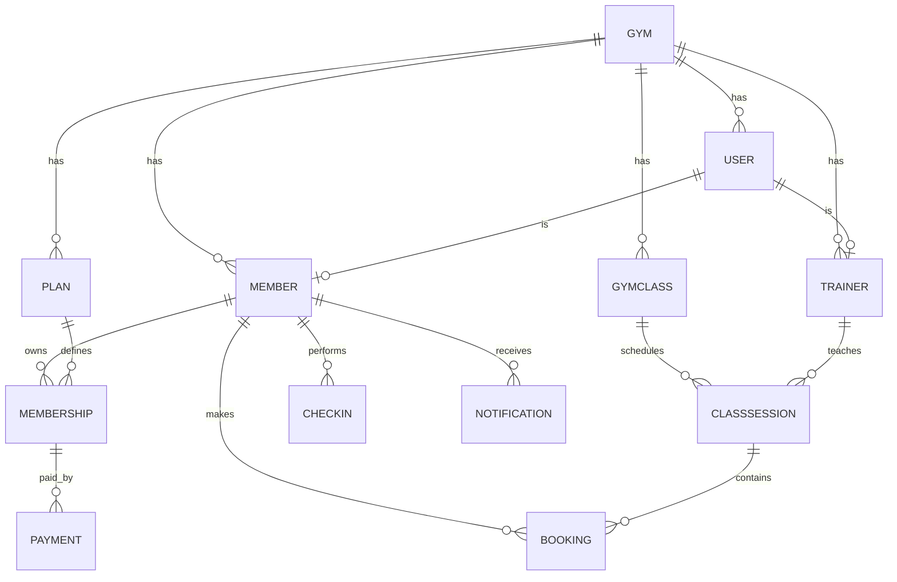

# Mô Hình Dữ Liệu (ERD) — GymPilot

## Các Quy Tắc Dữ Liệu Quan Trọng
1. **User** là tài khoản đăng nhập (`email` unique, `passwordHash`). `Member` và `Trainer` là hồ sơ nghiệp vụ liên kết 1-1 với `User`.
2. **Membership** là một lần mua/sở hữu gói; một hội viên có thể có nhiều membership theo thời gian.
3. **GymClass** là loại lớp (ví dụ: *“Yoga sáng”*); **ClassSession** là một buổi cụ thể (ví dụ: *“Yoga sáng 06:00 ngày 10/11”*).
4. **Booking** ràng buộc unique theo cặp `[memberId, sessionId]` để tránh đặt trùng.
5. **CheckIn** ràng buộc một hội viên chỉ check-in một lần mỗi ngày.
6. **Payment** tách riêng khỏi Membership để sau này dễ mở rộng thanh toán trực tuyến, hoàn tiền và xuất hóa đơn.
